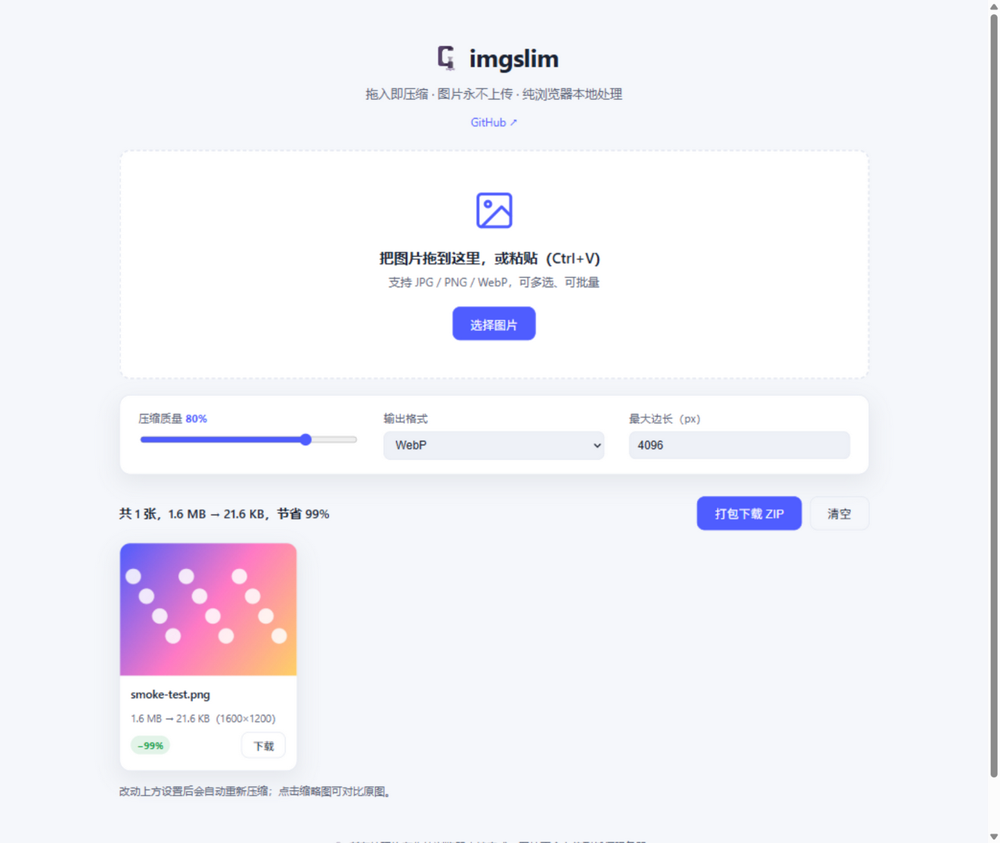

# 🗜️ imgslim

[](https://github.com/sworddemon85-create/imgslim/actions/workflows/ci.yml)
[](https://sworddemon85-create.github.io/imgslim/)
[](LICENSE)

**纯前端的图片压缩工具**：拖入图片即可压缩、转换格式、批量打包下载。所有处理都在浏览器本地完成，**图片不会上传到任何服务器**。

> A privacy-friendly image compressor that runs entirely in your browser — no uploads, no dependencies, no build step.



## ✨ 特性

- **隐私安全** — 基于 Canvas API 在浏览器内压缩，零网络请求，断网也能用
- **零依赖** — 无框架、无构建、无第三方库，克隆即用
- **常用预设** — 一键切换「微信/QQ 传图」「朋友圈」「网页用图」「仅转格式」，自动套用合适的质量与尺寸
- **批量处理** — 支持多选、拖拽（可拖入整个文件夹）、Ctrl+V 粘贴，一键打包 ZIP 下载（ZIP 打包也是手写的，零依赖）
- **格式转换** — 输出 JPEG / PNG / WebP，或与原图保持一致
- **质量与尺寸可调** — 压缩质量滑块 + 最大边长限制，改动后自动重新压缩
- **可安装的 PWA** — 在浏览器里"安装"到桌面/手机后完全离线可用
- **图片拼接** — 多张图一键拼成一张网格大图（九宫格风格），格子尺寸/间距/填充方式/背景可调，实时预览
- **前后对比** — 点击缩略图查看压缩前后的视觉差异
- **深色模式** — 自动跟随系统偏好

## 💡 什么场景用得上

- 微信 / QQ / 邮件传图有体积限制，截图和照片动辄几 MB —— 拖进来一键压到能发的大小
- 往论坛、博客、文档里贴图，需要控制长边尺寸 —— 用预设或手动设置最大边长
- 公司截图、私人照片不想经过任何第三方服务器 —— imgslim 全程本地处理，可断网使用
- 批量整理相册、给网站图片瘦身 —— 拖入整个文件夹，打包 ZIP 下载

## 🖥️ 在线使用

直接访问 GitHub Pages 部署的版本：

**https://sworddemon85-create.github.io/imgslim/**

## 🚀 本地运行

需要 Node.js 18+（仅用于本地预览服务器和跑测试，页面本身零依赖）：

```bash
git clone https://github.com/sworddemon85-create/imgslim.git
cd imgslim
npm start          # 启动本地服务器，访问 http://localhost:8080
```

> 直接双击打开 `index.html` 也可以使用，但部分浏览器在 `file://` 协议下会限制 Canvas 功能，推荐走 HTTP。

## 🧪 运行测试

```bash
npm test           # node --test test/
```

测试覆盖三组核心逻辑：`js/utils.js`（字节格式化、等比缩放计算等）、`js/zip.js`（CRC32 标准向量、ZIP 结构合法性）与 `js/collage.js`（网格布局、居中裁剪、画布尺寸计算）。

## 📁 项目结构

```
imgslim/
├── index.html            # 页面入口
├── css/style.css         # 样式（浅色/深色自适应）
├── js/utils.js           # 通用工具函数（浏览器/Node 通用）
├── js/zip.js             # 零依赖 store 模式 ZIP 打包器
├── js/collage.js         # 拼图几何计算（网格布局/裁剪/尺寸，浏览器/Node 通用）
├── js/app.js             # 主逻辑：选图 → 压缩 → 预览/下载/拼接
├── sw.js                 # Service Worker：离线缓存
├── manifest.webmanifest  # PWA 清单
├── icons/                # 应用图标（192/512）
├── server.js             # 零依赖本地开发服务器
├── test/                 # node:test 单元测试
└── .github/workflows/    # CI（单元测试）+ GitHub Pages 部署
```

## 🛠️ 技术说明

- 压缩通过 `canvas.toBlob()` 完成：图片先绘制到按最大边长等比缩放的画布，再以指定 MIME 和质量重新编码
- ZIP 打包为手写的 **store（仅存储）模式**：图片本身已是压缩格式，无需再次压缩，只需正确写入本地文件头、中央目录与 CRC32 校验
- 输出格式与原图一致时保留原始 MIME，避免 JPEG/PNG 混用带来的透明度或体积问题

## ⚠️ 已知限制

- GIF 会被压缩为静态首帧（浏览器 Canvas 限制）
- 部分浏览器（如较旧的 Safari）不支持 Canvas 导出 WebP，此时请选择 JPEG/PNG
- HEIC/HEIF 等格式依赖系统能力，多数浏览器无法解码，会明确报错提示

## 🤝 贡献

欢迎 Issue 和 PR！提交前请确保 `npm test` 通过。

## 📄 许可证

[MIT](LICENSE)
